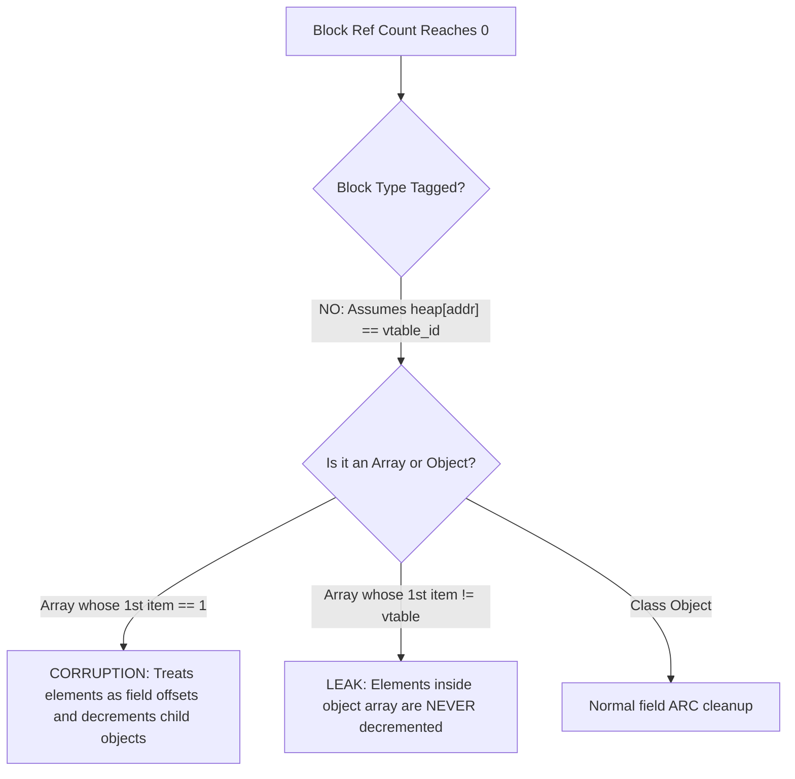

# Comprehensive Codebase Audit & v1.1.0 Architectural Roadmap

This document serves as the master engineering report for Solix, synthesizing:
1. **The exhaustive codebase defect & vulnerability audit** (runtime memory safety, ARC type confusion, VM stack bounds, OOB bytecode execution, LSP reactivity, CLI dependency resolution, build warnings, and code hygiene).
2. **New architectural and language features for the v1.1.0 development cycle**:
   - Migration from 64-bit word-addressed memory to **8-bit byte-addressed memory (`std::vector<uint8_t>`)**.
   - License transition from permissive MIT to a more restrictive license.
   - Project manifest redesign (`solix.json` -> `manifest.json` or unified project settings, library/project taxonomy).
   - Standard library (`solixlib`) cleanup: purging redundant boxed numeric classes (`Bool.slx`, `Byte.slx`, `Char.slx`, etc.) and resolving all 21 missing source dependencies.
   - Comprehensive cross-platform hardware, OS, and resource diagnostic system library (`solix.system.Hardware`, `SystemInfo`).
   - Disambiguation via Fully Qualified Symbol Paths in the compiler Binder.
   - Scaffolding improvements (`solix new` template for Hello World) and CLI UX (`solix activate vscode`).
   - Modernized `WORKFLOW.md` requiring synchronized VS Code extension grammar updates when language perks change.
   - Cross-language benchmark harness (Solix vs. Python, Lua, LuaJIT).
   - Wiki and documentation overhaul.

---

## Table of Contents

- [1. Exhaustive Defect & Safety Analysis](#1-exhaustive-defect--safety-analysis)
  - [1.1. Critical Runtime & Memory Hazards (`core/src/runtime.cpp`)](#11-critical-runtime--memory-hazards)
  - [1.2. CLI & Package Manager Gaps (`cli/`)](#12-cli--package-manager-gaps)
  - [1.3. Language Server (LSP) Bottlenecks (`lsp/`)](#13-language-server-lsp-bottlenecks)
  - [1.4. Standard Library (`solixlib/`) Implementation Inconsistencies](#14-standard-library-solixlib-implementation-inconsistencies)
  - [1.5. Build System & CI Hygiene Deficits](#15-build-system--ci-hygiene-deficits)
- [2. Major v1.1.0 Architectural Overhauls](#2-major-v110-architectural-overhauls)
  - [2.1. The Byte-Addressed Memory Model Transition (`uint64_t` -> `uint8_t`)](#21-the-byte-addressed-memory-model-transition)
  - [2.2. License Migration Strategy](#22-license-migration-strategy)
  - [2.3. Project Manifest Redesign (`manifest.json` & Library Taxonomy)](#23-project-manifest-redesign)
  - [2.4. Standard Library Pruning & Complete Manifest Ingestion](#24-standard-library-pruning--complete-manifest-ingestion)
  - [2.5. Comprehensive Cross-Platform System & Hardware Diagnostics](#25-comprehensive-cross-platform-system--hardware-diagnostics)
  - [2.6. Fully Qualified Symbol Disambiguation in Binder](#26-fully-qualified-symbol-disambiguation-in-binder)
  - [2.7. CLI Modernization: `solix new` Templates & `solix activate vscode`](#27-cli-modernization)
  - [2.8. Synchronized Language-Tooling Workflow (`WORKFLOW.md` & VS Code)](#28-synchronized-language-tooling-workflow)
  - [2.9. Comparative Performance Benchmarks (Solix vs. Python, Lua, LuaJIT)](#29-comparative-performance-benchmarks)
  - [2.10. Documentation & GitHub Wiki Restructuring](#210-documentation--github-wiki-restructuring)
- [3. Phased Implementation Roadmap for v1.1.0](#3-phased-implementation-roadmap-for-v110)

---

## 1. Exhaustive Defect & Safety Analysis

### 1.1. Critical Runtime & Memory Hazards
*Files: [`core/src/runtime.cpp`](core/src/runtime.cpp), [`core/include/solix/runtime.hpp`](core/include/solix/runtime.hpp)*



1. **Array vs. Object Type Confusion in ARC Destructor (`runtime.cpp:153-170`)**:
   - The heap stores only `size` and `ref_count` in the header word with no type tag.
   - When a block reaches ref count 0, the destructor assumes `heap[address]` is a `vtable_id`.
   - On arrays, `heap[address]` is the **first element**. If element 0 matches a valid `vtable_id` (e.g. `1`), the runtime misidentifies the array as an object and decrements arbitrary memory locations at class field offsets. If it does not match, elements inside object arrays are **never decremented**, leaking all array contents on deallocation.
2. **Missing Lifecycle Tracking on Array Mutation (`op_SET_ARRAY`, `runtime.cpp:911-924`)**:
   - Bytecode execution replaces the array element without decrementing the old occupant (`DEC_REF`) and without retaining the newly stored reference (`INC_REF`). Overwriting array slots in loops leads to permanent leaks of previous objects.
3. **Array Type Confusion in `op_INSTANCEOF` & `op_CAST_CHECK` (`runtime.cpp:1110-1155`)**:
   - `heap_data[obj]` is read directly as `current_vtable`. On primitive arrays or strings, word 0 is checked as a vtable ID, causing false positives or crashes.
4. **Unbounded VM Execution Stack (`runtime.cpp:284-288`)**:
   - `#define PUSH(val) (*sp++ = (val))` and `#define POP() (*--sp)` perform raw pointer arithmetic without checking bounds against `stack.data()`. Deep or infinite recursion corrupts process heap memory rather than throwing a `StackOverflowException`.
5. **Static/Dynamic Heap Overwrite Hazard (`runtime.cpp:14-63`)**:
   - Static allocations start at index 1 and grow upward; dynamic allocations start at `heap.size() / 2` and grow upward. If static allocations exceed `heap.size() / 2`, static objects silently overwrite dynamic objects without error.
6. **No Free Block Coalescing & Linear Free-List Scanning (`runtime.cpp:33-58`)**:
   - Freed blocks are appended to `free_blocks` and never merged. This creates high heap fragmentation and premature heap exhaustion. Furthermore, searching `free_blocks` on every allocation is an $O(N)$ linear scan, degrading allocation performance to $O(N^2)$.
7. **Malformed Bytecode Buffer Overruns (`runtime.cpp:216-241`)**:
   - Bytecode reading utilities (`read_u32`, `read_u64`, `read_string`) do not verify `pc + length <= bytecode.size()`. Truncated or corrupted `.slxbin` files result in out-of-bounds reads.
8. **Unchecked Computed Goto Jump Index (`runtime.cpp:311, 520`)**:
   - Direct-threaded dispatch executes `goto *dispatch_table[code[program_counter++]]` without verifying `opcode < 89`. An opcode `> 88` indexes past `dispatch_table` and jumps to arbitrary addresses.
9. **8x String Memory Inflation (`runtime.cpp:552-555`)**:
   - Every string character is stored as a 64-bit word (`uint64_t`), taking 8 bytes per character.

---

### 1.2. CLI & Package Manager Gaps
*Files: [`cli/src/package_manager.cpp`](cli/src/package_manager.cpp), [`cli/src/commands/execute.cpp`](cli/src/commands/execute.cpp)*

1. **Unsynchronized Registry Operations**:
   - `cli/src/package_manager.cpp:95-102` accesses `$SOLIX_HOME/installed.json` without file locking. Concurrent builds or package commands running in parallel can corrupt the JSON registry.
2. **Greedy Directory Copying**:
   - `cli/src/package_manager.cpp:154-165` only filters `build`, `.git`, and `.vscode`. Symlinks, test caches, and transient files are copied into the package store, risking circular symlink loops.
3. **Execution Working Directory Ambiguity**:
   - `cli/src/commands/execute.cpp:70-130` executes packages in the user's current directory rather than the package root, breaking relative file paths.

---

### 1.3. Language Server (LSP) Bottlenecks
*Files: [`lsp/src/server.cpp`](lsp/src/server.cpp)*

1. **Synchronous Full-Workspace Re-compilation on Every Keystroke**:
   - `lsp/src/server.cpp:162-174` triggers full dependency resolution, lexing, parsing, and type binding across all 60+ standard library files synchronously on every `didChange` notification.
2. **Missing Debounce & Single-Threaded Message Loop**:
   - The LSP thread blocks during compilation; rapid typing floods the server with redundant requests, creating noticeable lag in the editor.

---

### 1.4. Standard Library (`solixlib/`) Implementation Inconsistencies
*Files: [`solixlib/project/solix.json`](solixlib/project/solix.json), [`solixlib/native/src/`](solixlib/native/src/)*

1. **Manifest Omissions (21 Missing Source Files)**:
   - `solixlib/project/solix.json` omits 21 `.slx` files located under `solixlib/project/src/`, including `Crypto` (`Base64.slx`, `Hash.slx`, `Hex.slx`), `IO` (`BufferedReader.slx`, `FileStream.slx`, `StreamReader.slx`, `StreamWriter.slx`, `MemoryStream.slx`, `FileMode.slx`, `IStream.slx`), `System` (`Environment.slx`, `Process.slx`, `ProcessResult.slx`), and 8 boxed numeric wrappers.
2. **Duplicated Native String/Array Marshalling**:
   - Native modules (`console.cpp`, `crypto.cpp`, `io_fs.cpp`, `io_stream.cpp`, `string.cpp`, `system.cpp`) each reimplement identical `read_solix_chars` and `allocate_solix_chars` helper functions with no shared header.
3. **Unchecked Heap Offsets in Native IO**:
   - `read_solix_chars` reads `heap[addr + i]` without verifying `addr + i < heap.size()`.

---

### 1.5. Build System & CI Hygiene Deficits
*Files: [`CMakeLists.txt`](CMakeLists.txt), [`.github/workflows/integration.yml`](.github/workflows/integration.yml)*

1. **Missing Compiler Warnings**:
   - The root CMakeLists does not enable `-Wall -Wextra -Wpedantic` (GCC/Clang) or `/W4 /WX` (MSVC).
2. **Absence of Memory Sanitizers in CI**:
   - CI runs standard Release and Debug builds without `-fsanitize=address,undefined`.

---

## 2. Major v1.1.0 Architectural Overhauls

### 2.1. The Byte-Addressed Memory Model Transition
*Refactoring VM heap from `std::vector<uint64_t>` to `std::vector<uint8_t>`*

#### Why Byte Addressing?
- **Word-addressed waste**: Storing an 8-bit `char` or `bool` in a 64-bit word wastes 87.5% of memory.
- **Interoperability**: Cannot pass string buffers or byte arrays to C/C++ libraries (Raylib, OpenGL, POSIX sockets) without copying and unpacking 64-bit words into contiguous byte arrays.
- **Natural Packing**: Byte addressing enables compact class layouts where multiple narrow fields share adjacent bytes.

#### Architectural Requirements & Migration Plan

```mermaid
flowchart TD
    subgraph Word-Addressed (Current v1.0.0)
        W1["heap[addr - 1] (64 bits: size | ref_count)"]
        W2["heap[addr + 0] (64 bits: vtable_id)"]
        W3["heap[addr + 1] (64 bits: bool field - 7 bytes wasted)"]
        W4["heap[addr + 2] (64 bits: char field - 7 bytes wasted)"]
    end
    subgraph Byte-Addressed (Target v1.1.0)
        B1["heap[addr - 8 .. -1] (64-bit header: size_in_bytes | tags | ref_count)"]
        B2["heap[addr + 0 .. +3] (32-bit vtable_id)"]
        B3["heap[addr + 4] (1-byte bool field)"]
        B4["heap[addr + 5] (1-byte char field)"]
        B5["heap[addr + 6 .. +7] (2-byte padding for 4/8-byte alignment)"]
    end
```

1. **Heap Container**:
   - Change `Memory::heap` from `std::vector<uint64_t>` to `std::vector<uint8_t>`.
   - The operand stack (`Memory::stack`) remains `std::vector<uint64_t>` so that CPU registers and primitive values operate efficiently without sub-word stack penalties.
2. **Safe Inline Memory Access Primitives (`std::memcpy`)**:
   Implement standard unaligned-safe accessors in `solix::Memory`:
   ```cpp
   inline uint8_t read_u8(Address addr, uint32_t offset) const {
       return heap[addr + offset];
   }
   inline void write_u8(Address addr, uint32_t offset, uint8_t val) {
       heap[addr + offset] = val;
   }
   inline uint32_t read_u32(Address addr, uint32_t offset) const {
       uint32_t v;
       std::memcpy(&v, &heap[addr + offset], sizeof(v));
       return v;
   }
   inline void write_u32(Address addr, uint32_t offset, uint32_t val) {
       std::memcpy(&heap[addr + offset], &val, sizeof(val));
   }
   inline uint64_t read_u64(Address addr, uint32_t offset) const {
       uint64_t v;
       std::memcpy(&v, &heap[addr + offset], sizeof(v));
       return v;
   }
   inline void write_u64(Address addr, uint32_t offset, uint64_t val) {
       std::memcpy(&heap[addr + offset], &val, sizeof(val));
   }
   ```
3. **Object & ARC Layout (Byte Offsets)**:
   - Object Header: Positioned at byte offset `address - 8`.
     - Layout: `[ uint32_t size_in_bytes | uint4_t tag | uint28_t ref_count ]`.
   - Object Payload: Begins at `address`.
     - Byte offset `+0`: `uint32_t vtable_id` (4 bytes).
     - Byte offsets `+4` and beyond: packed instance fields.
   - Deallocation: `deallocate(address)` reads header at `address - 8` and frees `size_in_bytes + 8` bytes.
4. **Compiler Layout Calculator (`core/src/processes/binder.cpp:1352`)**:
   Update `Binder::calculate_layout`:
   - Start object payload offset at 4 (reserving 4 bytes for `vtable_id`).
   - For each field, compute natural alignment:
     - `bool`, `char`, `int8`, `uint8`: size 1, alignment 1.
     - `int16`, `uint16`: size 2, alignment 2.
     - `int32`, `uint32`, `float`: size 4, alignment 4.
     - `int64`, `uint64`, `double`, reference types: size 8, alignment 8.
   - Align current byte offset: `offset = (offset + align - 1) & ~(align - 1)`.
   - Assign `field->memory_index = offset` (now a byte offset, not word index).
   - Pad total object size to 8-byte boundary: `cls->instance_size = (offset + 7) & ~7`.
5. **Array Opcodes & Stride Awareness**:
   - `ALLOC_DYNAMIC`: Allocates `header (8 bytes) + length * element_stride`.
   - Store array length at `address - 8` (upper 32 bits of header or dedicated prefix).
   - `op_GET_ARRAY` / `op_SET_ARRAY`: Compute element byte offset as `array_addr + (index * stride)`.
   - Primitive byte arrays (`char[]`, `bool[]`, `byte[]`): Stride = 1.
   - Int32 / Float arrays: Stride = 4.
   - Int64 / Double / Reference arrays: Stride = 8.
   - Emits specialized opcodes: `GET_ARRAY_U8`, `SET_ARRAY_U8`, `GET_ARRAY_U32`, `SET_ARRAY_U32`, `GET_ARRAY_U64`, `SET_ARRAY_U64`.

---

### 2.2. License Migration Strategy
- **Current License**: MIT (Permissive).
- **Target License**: A more restrictive copyleft or source-available license:
  - **Option A: Mozilla Public License 2.0 (MPL-2.0)**: Weak copyleft at file level; requires modifications to Solix core files to be open-sourced while allowing commercial proprietary linking.
  - **Option B: GNU Lesser General Public License v3.0 (LGPL-3.0)**: Requires changes to the compiler/runtime to remain open-source while permitting proprietary user programs compiled with Solix.
  - **Option C: GNU General Public License v3.0 (GPL-3.0)**: Strong copyleft; guarantees the language and derivative tools remain permanently open-source.
- **Migration Deliverables**:
  - Replace `LICENSE.txt` in root.
  - Update `CPack` installer license references (`CMakeLists.txt`, `cmake/cpack_resources/LICENSE.txt`).
  - Update `solix new` manifest generator to use the selected license identifier.

---

### 2.3. Project Manifest Redesign (`manifest.json` & Library Taxonomy)
1. **File Renaming**:
   - Rename `solix.json` to **`manifest.json`** across the CLI, LSP, project templates, tests, and documentation.
   - Backward compatibility: The CLI and LSP will look for `manifest.json` first; if absent, they fall back to `solix.json` with a deprecation warning.
2. **Library vs. Project Dependency Taxonomy**:
   - In `manifest.json`, replace:
     ```json
     { "type": "project", "name": "foo" }
     ```
     with:
     ```json
     { "type": "library", "name": "foo", "version": "^1.0.0" }
     ```
   - Clarifies whether a dependency is a shared reusable compiled library or an in-source project module.

---

### 2.4. Standard Library Pruning & Complete Manifest Ingestion
1. **Purging Obsolete Boxed Numeric Classes**:
   - Solix primitives (`int32`, `int64`, `float`, `double`, `bool`, `char`, `byte`, `uint32`, etc.) are first-class value types in the VM.
   - Remove redundant boxed wrapper files:
     - `solixlib/project/src/solix/core/Bool.slx`
     - `solixlib/project/src/solix/core/Byte.slx`
     - `solixlib/project/src/solix/core/Char.slx`
     - `solixlib/project/src/solix/core/Double.slx`
     - `solixlib/project/src/solix/core/Float.slx`
     - `solixlib/project/src/solix/core/Int.slx`
     - `solixlib/project/src/solix/core/Long.slx`
     - `solixlib/project/src/solix/core/Short.slx`
     - `solixlib/project/src/solix/core/UByte.slx`
     - `solixlib/project/src/solix/core/UInt.slx`
     - `solixlib/project/src/solix/core/ULong.slx`
     - `solixlib/project/src/solix/core/UShort.slx`
   - Keep static utility helpers inside `solix.core.Primitives` (e.g. `Primitives.parse_int`, `Primitives.to_string`).
2. **Adding Missing 21 Files to `manifest.json`**:
   - Enumerate all remaining active source files in `solixlib/project/manifest.json`:
     - Crypto: `Base64.slx`, `Hash.slx`, `Hex.slx`
     - IO: `BufferedReader.slx`, `FileStream.slx`, `StreamReader.slx`, `StreamWriter.slx`, `MemoryStream.slx`, `FileMode.slx`, `IStream.slx`
     - System: `Environment.slx`, `Process.slx`, `ProcessResult.slx`
     - Time & Collections: all active modules.

---

### 2.5. Comprehensive Cross-Platform System & Hardware Diagnostics
*Expanding `solixlib/native/src/system.cpp` with full hardware diagnostics*

Instead of minimal OS name/version queries, implement a comprehensive cross-platform system inspection module:

```solix
package solix.system;

class Hardware {
    public static string cpu_model();
    public static int32 cpu_cores();
    public static int32 cpu_logical_threads();
    public static float cpu_usage_percent();

    public static uint64 total_ram_bytes();
    public static uint64 available_ram_bytes();
    public static float ram_usage_percent();

    public static string gpu_renderer();
    public static string gpu_vendor();
    public static uint64 gpu_vram_total_bytes();
    public static uint64 gpu_vram_used_bytes();

    public static string os_distribution();
    public static string os_kernel_version();
    public static uint64 uptime_seconds();
}
```

- **Cross-Platform Implementation**:
  - **Linux**: Parse `/proc/cpuinfo`, `/proc/meminfo`, `/proc/stat`, and `/sys/class/drm/` (or NVML/glX via dlopen).
  - **Windows**: Use `GetSystemInfo`, `GlobalMemoryStatusEx`, `PDH` (Performance Data Helper) for CPU utilization, and `DXGI` / `WMI` (`Win32_VideoController`) for GPU details.
  - **macOS**: Use `sysctl` (`hw.model`, `hw.ncpu`, `hw.memsize`), `mach/host_info` for CPU/RAM usage, and `Metal` / `IOKit` for GPU information.

---

### 2.6. Fully Qualified Symbol Disambiguation in Binder
*Enabling `solix.system1.Console.error()` vs `solix.system2.Console.error()`*

#### User Query & Evaluation
> **User's Request:**
> Can I write the complete path of a symbol to differentiate between them?
> ```solix
> package solix.crypto;
> import solix.system1.Console;
> import solix.system2.Console;
> 
> int32 main() {
>     solix.system1.Console.error();
>     solix.system2.Console.error();
> 
>     system1.Console.error();
>     system2.Console.error();
>     return 0;
> }
> ```
> *Is `system1.Console.error()` recommended?*

#### Architectural Recommendation:
1. **Fully Qualified Paths (`solix.system1.Console.error()`): RECOMMENDED & ESSENTIAL**
   - When two packages export a class with the same name (e.g. `solix.system1.Console` and `solix.system2.Console`), unqualified `Console` is ambiguous.
   - The compiler must allow specifying the full canonical namespace `solix.system1.Console.error()` to resolve the ambiguity without renaming imports.
2. **Partial Package Suffix Paths (`system1.Console.error()`): NOT RECOMMENDED**
   - **Reasoning**: If the current package is `solix.crypto` and neither `system1` nor `solix` is a local variable, treating `system1.Console` as a relative package prefix introduces ambiguous lookups, breaks standard lexical scoping rules, and conflicts with object member access if a local variable or field named `system1` exists.
   - **Standard Pattern**: In modern languages (Go, Rust, C#, Kotlin), disambiguation is achieved either via:
     - **Fully qualified paths from root**: `solix.system1.Console.error()`.
     - **Import aliases**: `import solix.system1.Console as Console1; Console1.error();`.
3. **Implementation Plan in Binder**:
   - In `core/src/processes/binder.cpp:476` (`resolve_symbol`), when a multi-segment identifier (`A.B.C`) matches a package path + class name, treat the leading segments as the package qualifier and bind directly to the specific class declaration.

---

### 2.7. CLI Modernization
1. **`solix new` Scaffolding Template (Hello World Standard)**:
   - Update `cli/src/commands/new.cpp`:
     - Generate `src/main.slx` printing `"Hello, World!"`:
       ```solix
       import solix.system.Console;

       int32 main() {
           Console.println("Hello, World!");
           return 0;
       }
       ```
     - Add manifest dependency on `solixlib` by default so standard console I/O works immediately after `solix new my_project`.
2. **`solix activate vscode`**:
   - Modernize `cli/src/commands/ide.cpp`:
   - Replace or alias `solix ide install` with `solix activate vscode` (and `solix activate cursor`).
   - Automatically unpacks and registers the bundled `.vsix` extension with the targeted editor CLI.

---

### 2.8. Synchronized Language-Tooling Workflow (`WORKFLOW.md` & VS Code)
Whenever a language construct, statement, keyword, or standard library module is added or altered:
1. **Mandatory Extension Grammar Synchronization**:
   - Update TextMate grammar: `editors/vscode/syntaxes/solix.tmLanguage.json`.
   - Update syntax configuration: `editors/vscode/language-configuration.json`.
   - Rebuild and package extension: `npm run package` in `editors/vscode/`.
2. **Workflow Rule in `docs/WORKFLOW.md`**:
   - Add Step 4b to `docs/WORKFLOW.md`: No language perk or statement may be committed to a phase branch without corresponding updates and tests in `editors/vscode/`.

---

### 2.9. Comparative Performance Benchmarks (Solix vs. Python, Lua, LuaJIT)
Create a dedicated benchmarking suite in `benchmarks/`:
- **Fibonacci (Recursive)**: Tests function call overhead, frame allocation, and stack manipulation.
- **Binary Trees**: Tests dynamic memory allocation throughput and ARC cleanup.
- **N-Body / Mandelbrot**: Tests numeric computation, loop execution, and arithmetic operations.
- **String Concatenation / Mutation**: Compares string buffer allocation and memory usage.
- Automated runner script: `benchmarks/run.py` generating Markdown tables and CSV plots comparing Solix against CPython 3.12, PUC Lua 5.4, and LuaJIT 2.1.

---

### 2.10. Documentation & GitHub Wiki Restructuring
1. **Wiki Cleanup**:
   - Fix broken links in `docs/guide/README.md` (e.g. pointing to non-existent `docs/wiki/stdlib/`).
   - Restructure `docs/wiki/` into a complete, clean GitHub Wiki layout:
     - `Home.md`
     - `Language-Syntax.md`
     - `Standard-Library.md`
     - `Architecture-and-Memory-Model.md`
     - `CLI-and-Toolchain.md`
     - `Cookbook-and-Tutorials.md`
2. **Example Projects**:
   - Add production-quality example applications under `examples/`:
     - `examples/01_hello_world/`
     - `examples/02_file_watcher/`
     - `examples/03_json_parser/`
     - `examples/04_http_client/`
     - `examples/05_system_dashboard/` (showcasing hardware & resource stats)

---

## 3. Phased Implementation Roadmap for v1.1.0

| Phase | Title | Scope & Key Deliverables |
| :--- | :--- | :--- |
| **Phase 1** | **Build & Hygiene Foundation** | Add `-Wall -Wextra -Werror` / `/W4`, add ASan/UBSan CI pipelines, fix all compiler warnings. |
| **Phase 2** | **Manifest & Project Redesign** | Rename `solix.json` -> `manifest.json`, introduce `{ "type": "library" }`, add Hello World template in `solix new`, add `solix activate vscode`. |
| **Phase 3** | **Standard Library Pruning** | Remove boxed numeric wrappers (`Bool.slx`, `Byte.slx`, etc.), add 21 missing source files to `manifest.json`, verify tests pass. |
| **Phase 4** | **Byte-Addressed Memory Model** | Convert `Memory::heap` to `std::vector<uint8_t>`, implement unaligned `memcpy` accessors, update Binder layout calculator for byte packing, update array opcodes for type-aware strides. |
| **Phase 5** | **Heap Allocator & ARC Overhaul** | Tagged block headers (4-bit type tags), free block coalescing ($O(1)$ buddy/binned lists), fix `op_SET_ARRAY` ARC tracking, resolve array vs object type confusion. |
| **Phase 6** | **Disambiguation & Fully Qualified Symbols** | Update Binder `resolve_symbol` to support fully qualified symbol paths (`solix.system1.Console.error()`), update package resolution. |
| **Phase 7** | **System & Hardware Diagnostics** | Implement `solix.system.Hardware` in `system.cpp` (CPU, GPU, RAM, usage %, OS distro, uptime) for Linux, Windows, and macOS. |
| **Phase 8** | **LSP Responsiveness & Debouncing** | Decouple LSP message pump, add 300ms change debouncer, background compilation worker, and AST caching for `solixlib`. |
| **Phase 9** | **License & Workflow Modernization** | Adopt new copyleft license, update `WORKFLOW.md` to mandate VS Code extension grammar sync on language changes. |
| **Phase 10** | **Benchmarks, Examples & Wiki Restructure**| Create benchmark suite vs Python/Lua/LuaJIT, add `examples/` projects, reorganize `docs/wiki/` for GitHub Wiki publication. |
