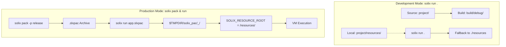

# Application Packaging & Resources

This guide explains how to package Solix applications into single-file portable distribution archives (`.slxpac`), bundle native shared libraries and static assets, and access internal resources using the `solix.io.filesystem.Resource` API.

---

## Table of Contents

1. [Introduction](#introduction)
2. [The Anatomy of a `.slxpac` Bundle](#the-anatomy-of-a-slxpac-bundle)
3. [Packaging with `solix pack`](#packaging-with-solix-pack)
4. [Executing Bundles with `solix run`](#executing-bundles-with-solix-run)
5. [The Resource API (`solix.io.filesystem.Resource`)](#the-resource-api-solixiofilesystemresource)
6. [The `res://` Virtual URI Scheme](#the-res-virtual-uri-scheme)
7. [Dual-Location Filesystem API](#dual-location-filesystem-api)
8. [Development vs. Production Workflow](#development-vs-production-workflow)
9. [Summary of Best Practices](#summary-of-best-practices)

---

## Introduction

Modern applications frequently require more than just compiled bytecode: they depend on native shared libraries (such as platform drivers, cryptographic helpers, or audio/graphics bindings) and static asset files (such as configuration files, localization files, shaders, templates, and icons).

Solix provides a unified, cross-platform packaging solution:
- **`solix pack`**: Assembles your compiled bytecode, native libraries (`lib/`), and static resources (`resources/`) into a single, self-contained, compressed `.slxpac` archive.
- **`solix run`**: Directly ingests, unpacks to a content-hashed cache, loads bundled native libraries, and executes `.slxpac` bundles with zero manual extraction.
- **`Resource` & `res://`**: Standard library APIs to access bundled assets cleanly from Solix code regardless of whether running from source or from an archive.

---

## The Anatomy of a `.slxpac` Bundle

An `.slxpac` file is a ZIP-compatible archive containing a deterministic internal folder structure:

```
my_app.slxpac
├── manifest.json       # Project metadata, profile configuration, and package entry
├── bytecode.slxbin     # Compiled Solix bytecode for the selected profile
├── lib/                # Native shared libraries (.so, .dll, .dylib)
│   ├── libplugin.so
│   └── solixlib_native.so
└── resources/          # Static application assets
    ├── config.json
    ├── templates/
    │   └── email.html
    └── assets/
        └── logo.png
```

| Path | Required | Purpose |
|---|---|---|
| `manifest.json` | **Yes** | Cloned project manifest identifying name, version, entry point, and profile details. |
| `bytecode.slxbin` | **Yes** | Compiled bytecode binary produced during project build. |
| `lib/` | Optional | Shared libraries loaded automatically by the runtime VM into the native registry. |
| `resources/` | Optional | Static asset files mounted as the application resource root. |

---

## Packaging with `solix pack`

The `solix pack` command builds the specified project and packages the build artifacts into an `.slxpac` bundle.

### Basic Invocations

Pack the current directory:
```bash
solix pack
```
This builds the default `debug` profile and emits `<project_name>.slxpac` into the project root.

Pack with a specific build profile (e.g. `release`):
```bash
solix pack -p release
```

Pack into a custom output file or directory:
```bash
solix pack -p release -o dist/my_app_v1.0.slxpac
```

Pack a target project located in another directory:
```bash
solix pack /path/to/project -o /dist/app.slxpac
```

### Packaging Options

| Option | Short Flag | Description | Default |
|---|---|---|---|
| `[target]` | - | Target project directory containing `manifest.json` or `solix.json` | `.` (current directory) |
| `--profile` | `-p` | Build profile defined in the manifest | `debug` |
| `--output` | `-o` | Destination path for the generated `.slxpac` archive | `<target>/<project>.slxpac` |

---

## Executing Bundles with `solix run`

The `solix run` launcher command accepts `.slxpac` bundle archives directly:

```bash
solix run dist/my_app_v1.0.slxpac
```

You can pass command-line arguments to the application after `--`:
```bash
solix run dist/my_app_v1.0.slxpac -- --verbose --port 8080
```

### Content-Hashed Execution Cache

When executing an `.slxpac` archive:
1. `solix run` computes a deterministic SHA-256 hash of the archive contents.
2. The package is unpacked into the system temporary cache:
   - **Linux / macOS**: `/tmp/solix_pac/<app_name>_<sha256_short>/`
   - **Windows**: `%TEMP%\solix_pac\<app_name>_<sha256_short>\`
3. If an identical bundle was previously unpacked and remains unmodified, extraction is skipped and execution begins immediately ($O(1)$ startup).
4. All native shared libraries found in `lib/` are automatically registered into `RuntimeOptions::native_libraries`.
5. The `resources/` directory is mounted into `RuntimeOptions::resource_directory` and exported as `SOLIX_RESOURCE_ROOT`.
6. The VM boots and executes the bundled `bytecode.slxbin`.

---

## The Resource API (`solix.io.filesystem.Resource`)

To read bundled assets from inside your Solix program, import `solix.io.filesystem.Resource`:

```solix
import solix.io.filesystem.Resource;
import solix.collections.List;
import solix.core.String;
import solix.system.Console;

class App {
    public static int32 main() {
        // Query resource directory path
        String res_dir = Resource.get_resource_directory();
        Console.println("Resource root: " + res_dir);

        // Check if an asset exists
        if (Resource.exists(new String("config.json"))) {
            // Read entire text content
            String config_data = Resource.read_all_text(new String("config.json"));
            Console.println("Config content:\n" + config_data);
        }

        // Read all lines into a List<String>
        List<String> lines = Resource.read_all_lines(new String("templates/items.txt"));
        for (int32 i = 0; i < lines.size(); i = i + 1) {
            Console.println(lines.get(i));
        }

        // Resolve absolute path to a resource
        String logo_path = Resource.get_path(new String("assets/logo.png"));
        Console.println("Logo absolute path: " + logo_path);

        return 0;
    }
}
```

### Method Summary

| Method | Return Type | Description |
|---|---|---|
| `Resource.get_resource_directory()` | `String` | Returns the absolute path of the resource root directory. |
| `Resource.get_path(String rel_path)` | `String` | Returns the canonical absolute path of a relative resource path. |
| `Resource.exists(String rel_path)` | `bool` | Returns `true` if the resource exists and is a regular file. |
| `Resource.read_all_text(String rel_path)` | `String` | Reads all text from the resource. Throws `FileNotFoundException` if missing. |
| `Resource.read_all_lines(String rel_path)` | `List<String>` | Reads all lines from the resource into a `List<String>`. |

---

## The `res://` Virtual URI Scheme

For maximum convenience, all standard file reading and inspection operations support the `res://` virtual URI prefix scheme. Any path starting with `res://` is automatically redirected to the active resource directory:

```solix
import solix.io.filesystem.File;
import solix.io.filesystem.Path;
import solix.core.String;
import solix.system.Console;

class App {
    public static int32 main() {
        // Transparent read via File.read_all_text
        String cfg = File.read_all_text(new String("res://config.json"));
        Console.println(cfg);

        // Transparent existence check
        if (File.exists(new String("res://assets/banner.txt"))) {
            Console.println("Banner asset is present!");
        }

        // Querying with Path
        Path p = new Path("res://assets/banner.txt");
        if (p.is_resource()) {
            Console.println("Path is an application resource!");
        }

        return 0;
    }
}
```

---

## Dual-Location Filesystem API

When writing code that could read either from the host machine or from bundled application resources depending on user configuration, use the dual-location overloads on `File`:

```solix
import solix.io.filesystem.File;
import solix.core.String;

class ConfigLoader {
    // is_resource == true  -> loads from bundled resources/
    // is_resource == false -> loads from host filesystem
    public static String load_settings(String path, bool is_bundled) {
        if (!File.exists(path, is_bundled)) {
            return new String("{}");
        }
        return File.read_all_text(path, is_bundled);
    }
}
```

---

## Development vs. Production Workflow

Solix ensures zero code differences between local development and packaged distribution:



1. **During Development**:
   You can run unbundled via `solix run .` or `solix run build/debug/myapp.slxbin`. The runtime falls back to `<project_root>/resources/`.
2. **For Production**:
   Run `solix pack -p release -o myapp.slxpac`. The package is self-contained and ready to distribute to any machine with `solix`.

---

## Summary of Best Practices

1. **Keep Assets in `resources/`**: Place all read-only application assets inside `<project_root>/resources/`.
2. **Keep Native Libraries in `lib/`**: Place compiled C/C++ plugins (`.so`, `.dll`, `.dylib`) in `<project_root>/lib/`. They are bundled and registered automatically.
3. **Use `res://` for Uniform Paths**: Use `res://` URIs for internal assets so that configuration strings and file paths remain clear and distinct from host paths.
4. **Resources are Read-Only**: Bundled resources in `.slxpac` archives represent static assets. For writable data (user preferences, caches, logs), use standard host filesystem paths obtained via `Path.get_temp_path()` or environment paths.
