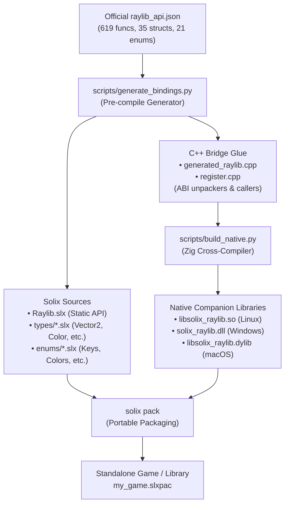
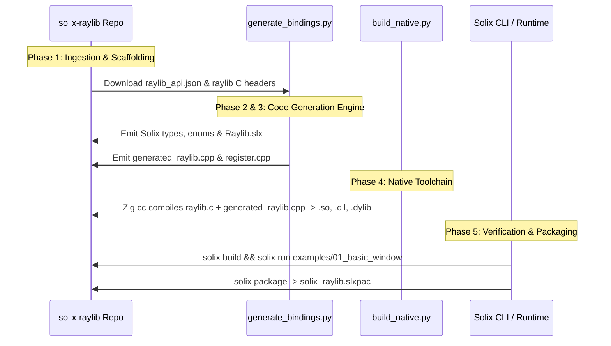

# Solix Raylib Binding: Architecture, API Ingestion & Implementation Plan

This document establishes the official architecture, upstream specification verification, and step-by-step engineering plan for **`solix-raylib`** — the official Raylib multi-platform game development and multimedia bindings for the Solix programming language.

---

## 1. Executive Summary & Vision

[Raylib](https://www.raylib.com/) is an industry-standard, hardware-accelerated C library for game development, audio processing, 3D graphics, and multimedia applications. 

By leveraging Solix's native companion libraries, lifecycle hooks (`pre_compile`), and portable archive format (`.slxpac`), `solix-raylib` enables developers to build high-performance 2D and 3D games in pure Solix and package them into self-contained, cross-platform executable bundles.



### Core Design Principles:
1. **Zero Manual FFI Maintenance**: Rather than manually writing 619+ C++ wrapper functions, both the Solix source declarations and C++ FFI bridges are **100% auto-generated** from the official `raylib_api.json`.
2. **Self-Contained Portability**: The native companion library statically links Raylib via Zig, eliminating external runtime dependencies (users do not need to install `libraylib` system packages).
3. **Idiomatic Solix Syntax**: Raylib C structs become Solix classes with constructors and fields (`Color.RED`, `new Vector2(100.0, 200.0)`).

---

## 2. Upstream Verification: Where to Find `raylib_api.json`

Raylib provides an official, machine-readable API specification maintained by Ramon Santamaria (`@raysan5`) using `rlparser`.

### Official Upstream Locations

| Target / Version | Upstream Status | Official Verified URL | API Coverage |
|---|---|---|---|
| **Raylib `master`** (Latest dev) | **Active & Verified** | [`https://raw.githubusercontent.com/raysan5/raylib/master/tools/rlparser/output/raylib_api.json`](https://raw.githubusercontent.com/raysan5/raylib/master/tools/rlparser/output/raylib_api.json) | 619 functions, 35 structs, 21 enums, 56 defines |
| **Raylib `5.5`** (Latest Stable) | **Active & Verified** | [`https://raw.githubusercontent.com/raysan5/raylib/5.5/parser/output/raylib_api.json`](https://raw.githubusercontent.com/raysan5/raylib/5.5/parser/output/raylib_api.json) | 581 functions, 34 structs, 21 enums |
| **Raylib `5.0`** (LTS) | **Active & Verified** | [`https://raw.githubusercontent.com/raysan5/raylib/5.0/parser/output/raylib_api.json`](https://raw.githubusercontent.com/raysan5/raylib/5.0/parser/output/raylib_api.json) | 529 functions, 32 structs, 20 enums |

> [!NOTE]
> On the Raylib `master` branch, the parser output directory was relocated from `parser/output/` to `tools/rlparser/output/`. Any tooling ingesting master must query `tools/rlparser/output/raylib_api.json`.

### Verified Structure of `raylib_api.json`

The JSON root contains 6 top-level arrays:
```json
{
  "defines": [...],    // Color literals (RAYWHITE, RED), constants, version macros
  "structs": [...],    // Vector2, Vector3, Matrix, Color, Rectangle, Image, Texture, etc.
  "aliases": [...],    // Texture2D -> Texture, Camera -> Camera3D, Quaternion -> Vector4
  "enums": [...],      // KeyboardKey, MouseButton, ConfigFlags, PixelFormat, etc.
  "callbacks": [...],  // AudioCallback, TraceLogCallback, etc.
  "functions": [...]   // InitWindow, BeginDrawing, DrawCircle, EndDrawing, etc.
}
```

#### Example Function Schema:
```json
{
  "name": "InitWindow",
  "description": "Initialize window and OpenGL context",
  "returnType": "void",
  "params": [
    { "type": "int", "name": "width" },
    { "type": "int", "name": "height" },
    { "type": "const char *", "name": "title" }
  ]
}
```

#### Example Struct Schema:
```json
{
  "name": "Vector2",
  "description": "Vector2, 2 components",
  "fields": [
    { "type": "float", "name": "x" },
    { "type": "float", "name": "y" }
  ]
}
```

---

## 3. Type Mapping & Marshaling Architecture

Solix operates with an ARC (Automatic Reference Counting) byte-addressed heap, passing primitive words (`uint64_t`) and heap object pointers across the native boundary.

### Type Translation Table

| Raylib C Type | Solix Type | C++ Marshaling from Solix (`args[i]`) | C++ Return to Solix (`uint64_t`) |
|---|---|---|---|
| `int`, `int32_t` | `int32` | `static_cast<int32_t>(args[i])` | `static_cast<uint64_t>(ret)` |
| `unsigned int` | `uint32` | `static_cast<uint32_t>(args[i])` | `static_cast<uint64_t>(ret)` |
| `float` | `float32` | `bit_cast_from_u64<float>(args[i])` | `bit_cast_to_u64<float>(ret)` |
| `double` | `float64` | `bit_cast_from_u64<double>(args[i])` | `bit_cast_to_u64<double>(ret)` |
| `bool` | `bool` | `args[i] != 0` | `ret ? 1 : 0` |
| `const char *` | `String` | `read_solix_chars(vm, args[i]).c_str()` | Allocate Solix String via `allocate_solix_chars` |
| `void` | `void` | N/A | `return 0;` |
| `Color` (by value) | `Color` (class) | `unpack_color(vm, args[i])` | `pack_color(vm, ret)` |
| `Vector2` (by value) | `Vector2` (class) | `unpack_vector2(vm, args[i])` | `pack_vector2(vm, ret)` |
| `Rectangle` (by value) | `Rectangle` (class) | `unpack_rectangle(vm, args[i])` | `pack_rectangle(vm, ret)` |
| `Texture2D` (handle) | `Texture2D` (class) | `unpack_texture(vm, args[i])` | `pack_texture(vm, ret)` |

### Struct Marshaling Mechanics:
- **Passing Struct to Native Function**:
  When a Solix caller passes `DrawCircleV(center, 10.0, Color.RED)`:
  - `args[0]` contains the heap address of `center` (`Vector2`).
  - C++ unpacker reads `x` (float at offset 0) and `y` (float at offset 4/8) and constructs `::Vector2{x, y}`.
- **Returning Struct from Native Function**:
  When a native function returns a struct (e.g., `GetMousePosition()` -> `::Vector2`):
  - C++ invokes `vm.memory.dynamic_allocation(total_fields_bytes, solix::BlockTag::OBJECT)`.
  - C++ writes `ret.x` and `ret.y` directly to heap offsets and returns the allocated address.

---

## 4. Project Layout

The library will be structured as a standard, canonical Solix package:

```
solix-raylib/
├── manifest.json                  # Solix package manifest with profiles & hooks
├── api/
│   └── raylib_api.json            # Official vendored Raylib API specification
├── scripts/
│   ├── generate_bindings.py       # Code generator (emits Solix and C++ glue)
│   └── build_native.py            # Zig multi-platform cross-compilation script
├── src/
│   └── raylib/
│       ├── Raylib.slx             # Primary API entry point (static methods)
│       ├── types/
│       │   ├── Vector2.slx        # 2D Vector
│       │   ├── Vector3.slx        # 3D Vector
│       │   ├── Color.slx          # RGBA Color
│       │   ├── Rectangle.slx      # 2D Rectangle
│       │   ├── Camera2D.slx       # 2D Camera
│       │   └── Texture2D.slx      # Texture handle
│       └── enums/
│           ├── KeyboardKey.slx    # Key codes (KEY_SPACE, KEY_ENTER, etc.)
│           ├── MouseButton.slx    # Mouse button constants
│           └── ConfigFlags.slx    # Window flags
├── native/
│   ├── include/
│   │   ├── raylib.h               # Official Raylib C header
│   │   ├── raymath.h              # Raylib Math C header
│   │   └── rlgl.h                 # OpenGL abstraction C header
│   └── src/
│       ├── generated_raylib.cpp   # 100% auto-generated C++ FFI bridge functions
│       ├── custom_glue.cpp        # Manual helpers / special callbacks
│       └── register.cpp           # solix_register_natives entry point
└── examples/
    ├── 01_basic_window/
    │   ├── manifest.json
    │   └── src/main.slx
    └── 02_bouncing_ball/
        ├── manifest.json
        └── src/main.slx
```

---

## 5. Implementation Roadmap & Phases



### Phase 1: Project Scaffolding & API Ingestion
- Initialize project structure with `manifest.json`.
- Fetch and vendor `raylib_api.json` from `https://raw.githubusercontent.com/raysan5/raylib/master/tools/rlparser/output/raylib_api.json`.
- Vendor Raylib C header (`raylib.h`) and implementation source (`raylib.c` amalgamation).

### Phase 2: The Binding Generator (`generate_bindings.py`)
- **Struct Generator**: Emits Solix classes with typed public fields, constructors, and factory methods.
- **Enum Generator**: Emits classes with static integer constants.
- **Defines Generator**: Parses color defines (`RAYWHITE`, `RED`, `GOLD`) and emits static `Color` constants.
- **Native Bridge Generator**: Emits C++ static functions for each Raylib function, marshaling arguments and return values.

### Phase 3: Core Graphic Loop Verification (Milestone 1)
- Verify minimal functional graphic loop:
  - `Raylib.init_window(800, 450, "Solix Raylib")`
  - `Raylib.set_target_fps(60)`
  - `Raylib.window_should_close()`
  - `Raylib.begin_drawing()`
  - `Raylib.clear_background(Color.RAYWHITE)`
  - `Raylib.draw_text("Hello Solix!", 190, 200, 20, Color.LIGHTGRAY)`
  - `Raylib.end_drawing()`
  - `Raylib.close_window()`
- Validate zero memory leaks and proper clean exit.

### Phase 4: Full API & Advanced Types (Milestone 2)
- Generate remaining 550+ functions:
  - Shapes (circles, rectangles, lines, polygons).
  - Textures & Images (`LoadTexture`, `DrawTextureV`, `UnloadTexture`).
  - 3D models & cameras (`BeginMode3D`, `DrawCube`, `DrawGrid`, `EndMode3D`).
  - Audio (`InitAudioDevice`, `LoadSound`, `PlaySound`, `CloseAudioDevice`).
  - Input polling (`IsKeyDown`, `IsMouseButtonPressed`, `GetMousePosition`).

### Phase 5: Zig Multi-Platform Cross-Compilation Pipeline
- Implement `scripts/build_native.py` using Zig:
  - Linux x86_64: `libsolix_raylib.so` (X11 / Wayland / DRM OpenGL)
  - Windows x86_64: `solix_raylib.dll` (GDI32 / WinMM / OpenGL32)
  - macOS ARM64 / x86_64: `libsolix_raylib.dylib` (Cocoa / IOKit / CoreVideo)
- Configure `manifest.json` with `pre_compile` hooks for zero-step builds.

### Phase 6: Packaging, Registry Distribution & Sample Games
- Package library via `solix pack -o solix_raylib.slxpac`.
- Create sample game: **Solix Snake** or **Bouncing Ball**.
- Test consumer application importing `solix_raylib` as a dependency.
